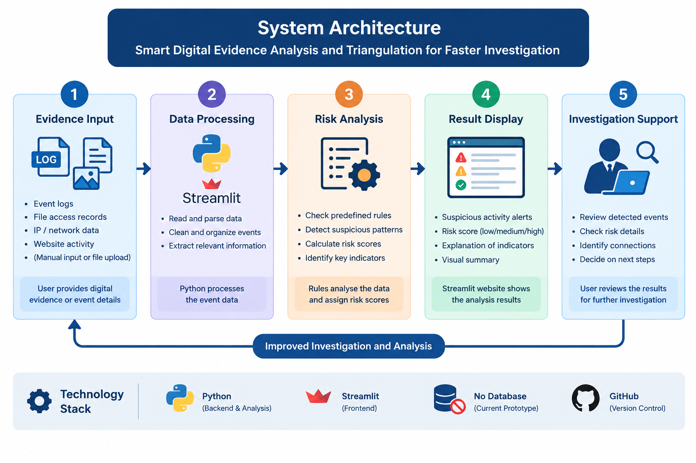
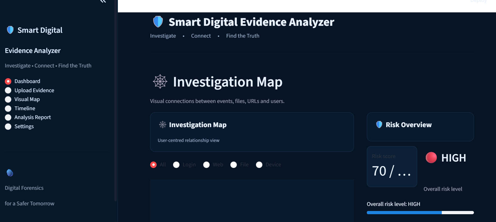
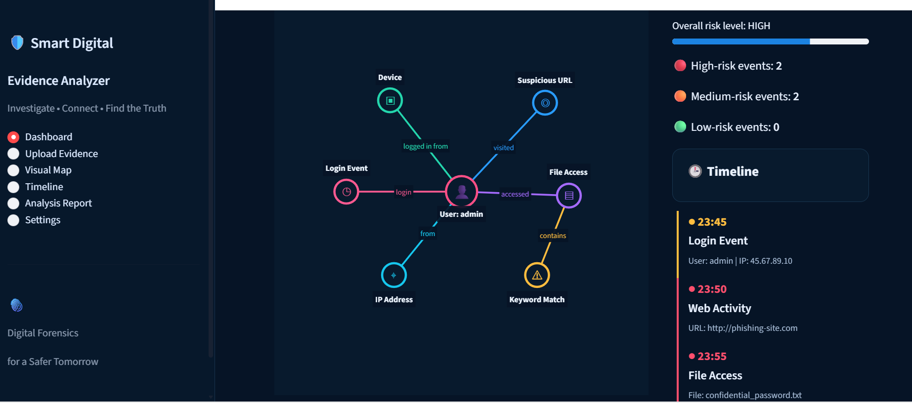
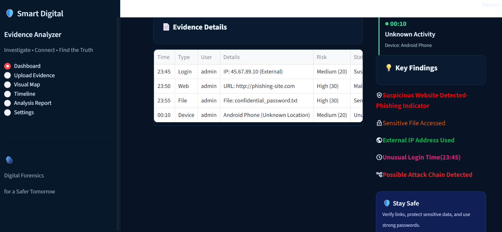

# Smart Digital Evidence Analysis and Triangulation for Fast Resolution of Investigations

**OPCODE IMPACT 2026 | Hackathon Submission**

**Team ID:** OPC036

## 1. Problem Statement

Digital investigations often involve examining multiple pieces of evidence, such as login records, timestamps, IP addresses, and suspicious activities. Manually examining these records can be time-consuming and make it difficult to identify connections between events. A simple, organized tool can help investigators review evidence and identify potentially suspicious patterns more efficiently.

## 2. Solution Title

**Smart Digital Evidence Analysis and Timeline generation for Faster Cyber Investigations**

## 3. Solution Description

Our solution is a beginner-level web-based prototype designed to support digital evidence analysis. It uses Python and Streamlit to examine structured digital event records and highlight potentially suspicious patterns based on predefined rules. The system can assign risk scores and display reasons for flagging particular events, helping users review evidence more systematically. The long-term goal is to help investigators compare multiple evidence sources and identify connections between events. The prototype supports preliminary analysis and does not independently establish guilt or prove a crime.

## 4. Architecture Diagram



**Workflow:** The user provides sample digital event data, the Python analysis logic checks the records against predefined rules, and the Streamlit interface displays the results and flagged activities. Future versions can incorporate evidence correlation and visualization.

## 5. Technology Stack

- **Frontend:** Streamlit web interface
- **Backend:** Python
- **Database:** Not implemented in the current prototype
- **Other Technologies:** Rule-based analysis, structured event data, GitHub

## 6. Quick Start Guide

**Prerequisites:**
- Python 3.12 or a compatible version
- pip package manager

**Installation & Execution:**

1. Install Streamlit:

```bash
pip install streamlit
```

2. Navigate to the folder containing your Python file.

3. Run the application:

```bash
streamlit run "app (4).py"
```

4. Open the local URL displayed in the terminal to access the website.
## 7. Output Screenshots




**Output Description:** The prototype presents the results of rule-based analysis, including flagged events, risk scores, and reasons for identifying potentially suspicious activity, depending on the implemented features.

## 8. Future Scope

- Integrate multiple digital evidence sources to identify relationships between events.
- Add interactive timelines and visual evidence-link diagrams.
- Improve analysis accuracy and reduce false positives.
- Support secure evidence handling and integrity verification.
- Add report generation and additional analysis rules.

## 9. Team Contributions

| Member Name | Contribution |
|---|---|
| AYSHA SHAFEEQUE | Project concept and problem identification |
| FIDHA FATHIMA A A| Python analysis logic and rule development |
| AYISHA T V | Streamlit interface and testing |
| ANAGHA P B | Documentation, research and presentation |

## 10. Tools Used

| Tool / Platform | Purpose / Why Used |
|---|---|
| Python | Implementing the evidence-analysis rules |
| Streamlit | Creating the interactive web interface |
| GitHub | Source-code hosting and project documentation |
| Visual Studio Code | Writing and editing code, if used |
| ChatGPT | Assistance with understanding code, debugging and documentation|

